# Fatzo Express: A Mobile Information and Order Gateway Application

## Members of Group 4:
* **Abegail P. Cailing**
* **John Daniel C. Dalaota**
* **Mary Geraldine B. Galang**

## Project Overview
**Fatzo Express** is a specialized mobile information gateway and booking assistance application designed for Fatzo Lechon & Catering Services. The application serves as an interactive catalog and direct order gateway that gives customers instant, 24/7 access to menu details, lechon weight options (in kg), catering package pricing, and business information without relying solely on manual phone calls and front-desk assistance.

## Integrated Core Features
* **Authentication & Security:** Secure sign-in and registration system powered by Supabase that differentiates between **Customers** and **Authorized Admin/Staff** accounts, ensuring users only access features intended for their role.
* **Order Gateway:** Embedded Google Form integration under the Order action field, allowing customers to input event details, contact information, and package selections directly without relying on external email clients.
* **Admin Management & Live Catalog Updates:** Dedicated staff dashboard connected to Supabase that enables administrators to update lechon availability, modify prices, edit package details, and update order statuses (Pending, Confirmed, Preparing) in real time.

## Identified Issues
**Session Management (Logout)** The Logout button did not redirect users back to the login page due to disconnected page views between the Client/Admin interfaces and the authentication screen. 

## Project Progress & Milestones
* **Milestone 1 (Project Proposal):** Defined problem statement, system scope, user flows, and UI/UX wireframes.
* **Milestone 2 (UI & Static Layouts):** Built base HTML/CSS screens (index.html, lechon.html, catering.html, contact.html, login.html, register.html and Admin layouts) and initial mobile viewport styling.
* **Milestone 3 (Core Feature Implementation):** Implemented Supabase authentication, admin CRUD controls, and refactored the order gateway to Google Forms.
* **Milestone 4 (Full Integration, Testing & Finalization):** Completed end-to-end component integration, input validation, error handling, UI/UX refinements, and comprehensive user-perspective QA testing.

## Testing documentation/results
## Admin Login Page 
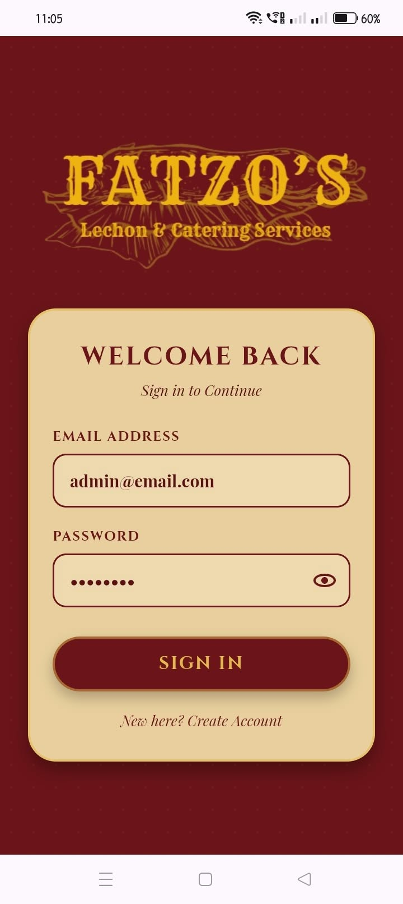
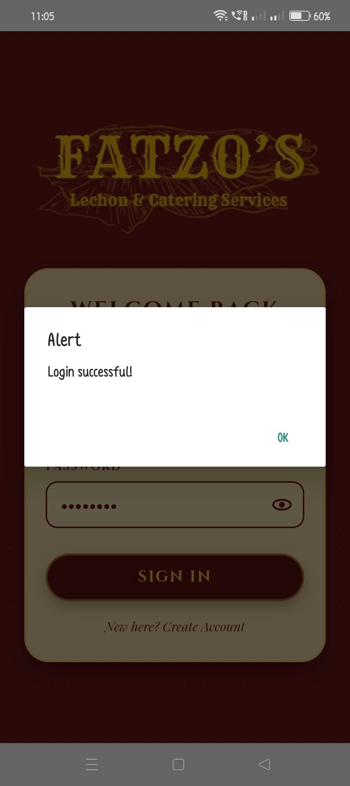

## Client Login and Registration Page
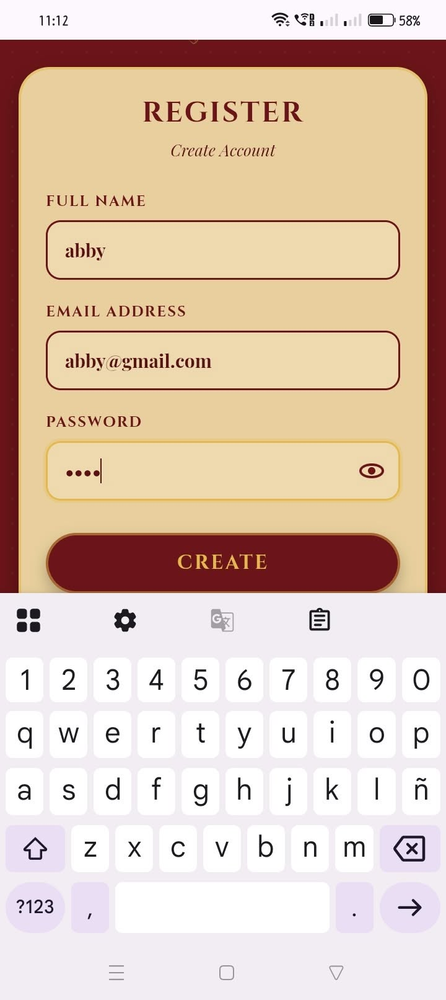
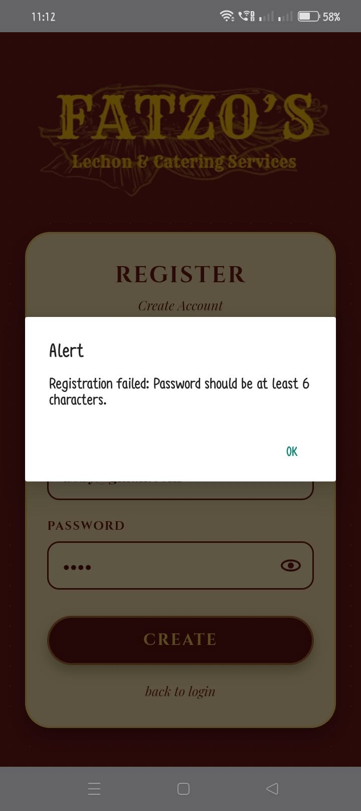
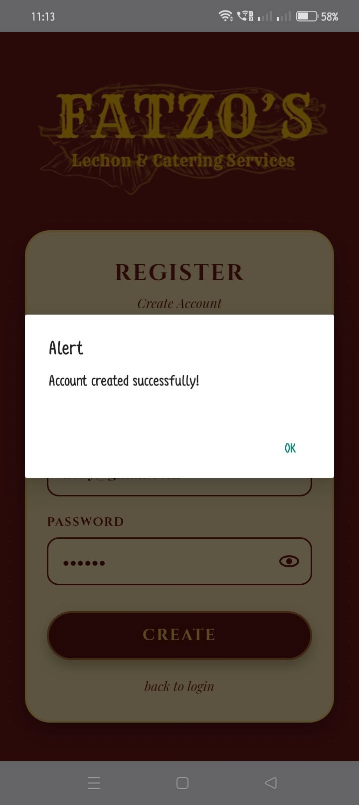

## Order Gateway Implementation
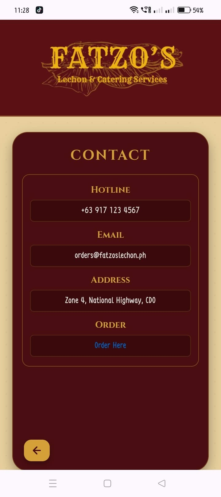
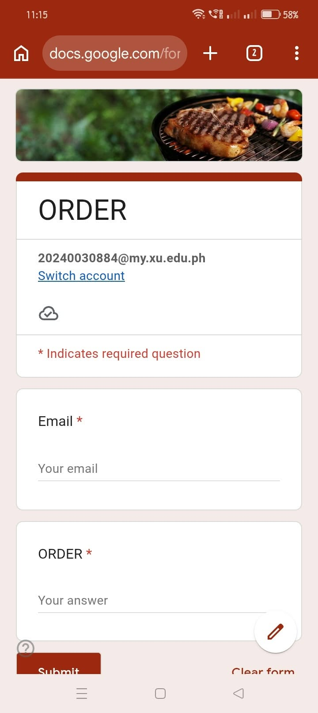
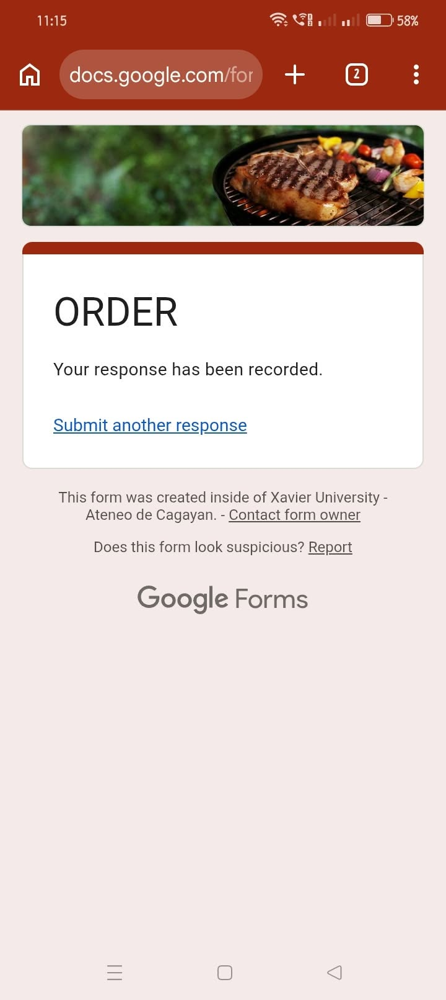

## Admin Management & Live Catalog Updates
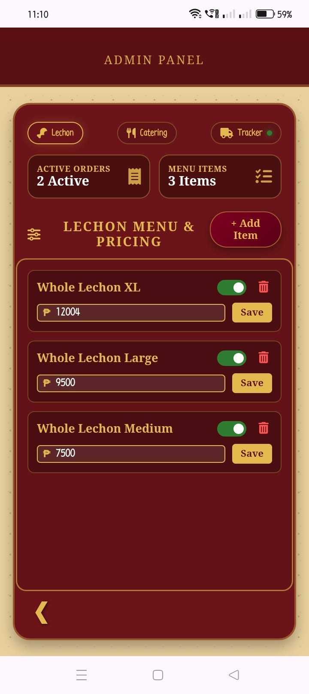
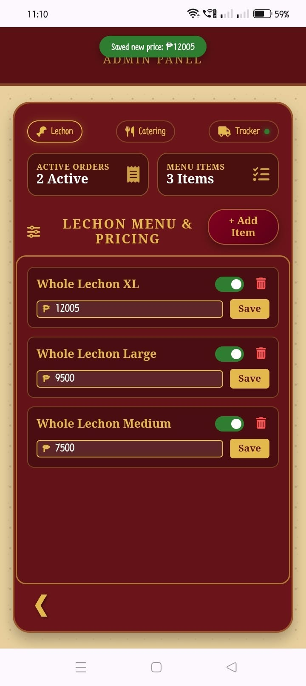
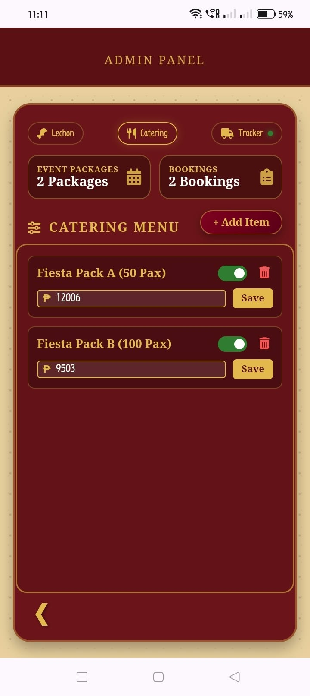
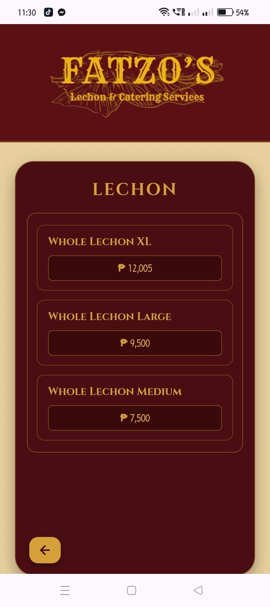
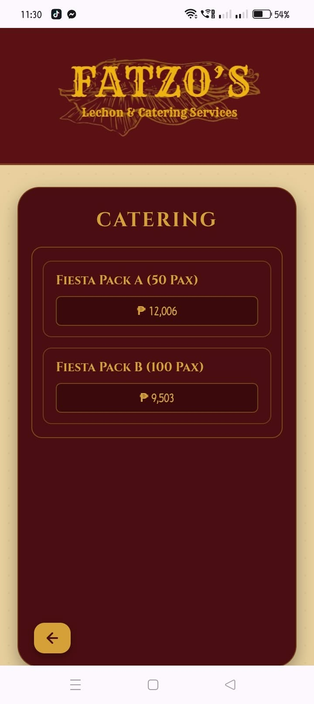
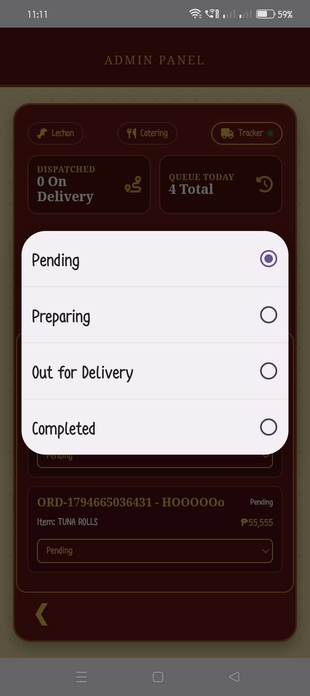
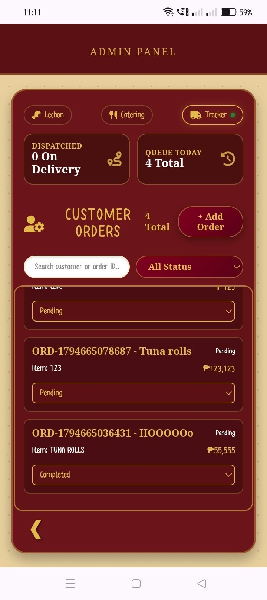

## Refinements
- Add logout button to Admin Panel
- The responsiveness of Admin Panel
- The consistent style and design of the panels